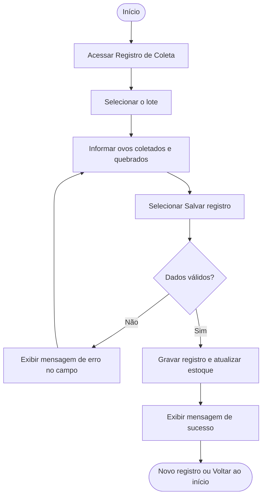

# Regra de Negócio / Fluxo

## Fluxo do Sistema - Registro de Coleta de Ovos

### Objetivo

A funcionalidade de registro de coleta permite que o funcionário informe, de forma simples e rápida, quantos ovos foram coletados em um lote de aves. Este documento apresenta o fluxo realizado pelo usuário desde a escolha do lote até a confirmação do registro e a atualização do estoque.

### Visão Geral

1. Acessar a tela de Registro de Coleta
2. Selecionar o lote
3. Informar a quantidade de ovos coletados
4. Informar a quantidade de ovos quebrados ou trincados
5. Selecionar **Salvar registro**
6. O sistema valida as informações
7. O sistema grava o registro e atualiza o estoque
8. O sistema apresenta a mensagem de sucesso
9. O usuário seleciona **Novo registro** ou **Voltar ao início**

## Fluxo da Funcionalidade

### Tela de registro de coleta

Nesta etapa, o funcionário escolhe o lote e informa os números da coleta. A tela apresenta os campos principais:

- **Lote:** lista dos lotes ativos da granja.
- **Data da coleta:** preenchida automaticamente com a data de hoje, podendo ser alterada.
- **Ovos coletados:** quantidade total de ovos recolhidos.
- **Ovos quebrados ou trincados:** quantidade de ovos que não servem para venda.
- **Observações:** campo opcional para anotações do dia.

Também estão disponíveis o botão **Salvar registro** e a opção **Voltar ao início**.

### Preenchimento dos dados

**Lote**
: O funcionário seleciona o lote em que a coleta foi feita. Somente lotes ativos aparecem na lista.

**Ovos coletados**
: Quantidade total recolhida. Deve ser um número inteiro maior ou igual a zero.

**Ovos quebrados ou trincados**
: Quantidade descartada. Não pode ser maior que o total coletado.

### Confirmação do registro

Depois de preencher os campos, o usuário seleciona o botão **Salvar registro**. A partir dessa ação, o sistema verifica as informações e, estando de acordo com as regras definidas, grava a coleta e atualiza o estoque de ovos.

### Tela de sucesso

O sistema informa que o registro foi salvo com sucesso e mostra o resumo: lote, data, ovos coletados, ovos descartados e ovos disponíveis para venda. Nessa etapa estão disponíveis os botões **Novo registro** e **Voltar ao início**.

### Verificação de alertas

Após a gravação, o sistema compara a produção do dia com a média recente do lote. Se a queda for significativa, a gestora recebe um alerta por WhatsApp (veja a regra RN06).

## Regras de negócio

| Código | Regra |
|---|---|
| RN01 | O registro só pode ser feito para um lote ativo. |
| RN02 | A quantidade de ovos coletados deve ser um número inteiro maior ou igual a zero. |
| RN03 | A quantidade de ovos quebrados não pode ser maior que a quantidade coletada. |
| RN04 | Os ovos disponíveis para venda são calculados como coletados menos quebrados e somados ao estoque. |
| RN05 | Um clique repetido em **Salvar registro** não pode gerar registro duplicado (controle de idempotência). |
| RN06 | Se a produção do dia ficar abaixo do limite definido em relação à média recente do lote, a gestora é avisada por WhatsApp. |

!!! note "Como a arquitetura participa"
    O Front-end envia o registro ao Back-end, que valida as regras, grava no PostgreSQL e usa o Redis para a idempotência (RN05) e para enfileirar o alerta (RN06). O envio do alerta é feito pela API do WhatsApp (Meta). Veja a página de [Arquitetura](arquitetura.md).

## Resumo do fluxo de registro de coleta

| Etapa | Ação do usuário | Resposta do sistema | Resultado |
|---|---|---|---|
| 01 - Acesso | Abre a tela de Registro de Coleta | Exibe o formulário com os lotes ativos | Tela disponível para preenchimento |
| 02 - Lote | Seleciona o lote | Carrega os dados do lote selecionado | Lote escolhido |
| 03 - Coleta | Informa ovos coletados e quebrados | Valida os valores nos campos | Dados preenchidos |
| 04 - Confirmar | Clica em **Salvar registro** | Inicia a validação das informações | Solicitação enviada |
| 05 - Validação | Aguarda o processamento | Verifica as regras RN01 a RN03 | Dados aprovados ou mensagem de erro |
| 06 - Gravação | Sem ação (automático) | Grava o registro e atualiza o estoque (RN04, RN05) | Estoque atualizado |
| 07 - Sucesso | Visualiza a confirmação | Exibe a mensagem com o resumo do registro | Registro concluído |
| 08 - Retorno | Clica em **Novo registro** ou **Voltar ao início** | Abre um novo formulário ou a tela inicial | Usuário pronto para a próxima ação |
